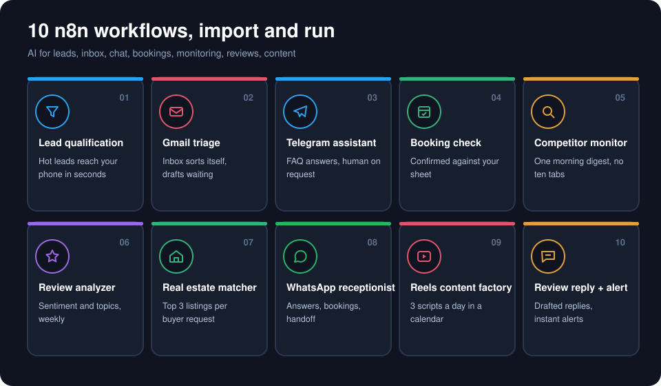
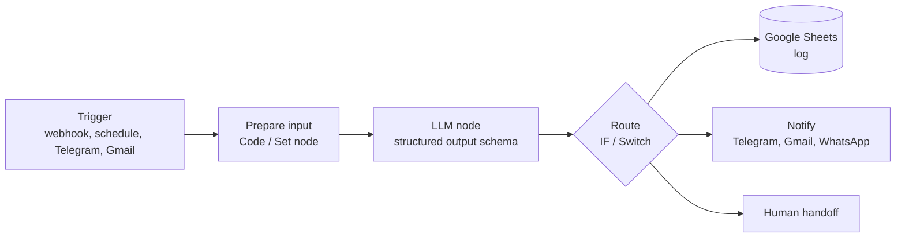

# n8n AI Automation Templates

Ten import-ready n8n workflows that put AI to work in everyday business processes: lead handling, inbox triage, customer chat, bookings, market monitoring, review analysis, real-estate lead matching, a WhatsApp receptionist, short-video content planning and review replies.

## Why this exists

Most n8n templates are demos that break on the first real input. These are small, complete flows with structured LLM output, sheet layouts and tuning notes, built so a business can import one, connect its own accounts and have it working the same day.
No keys are stored in the repo, and a validator checks every file on each push.

## Who it is for

Small and mid-size businesses, agencies and founders who want routine work off their plate, and teams that already run n8n and want solid starting points instead of a blank canvas.

## Workflows

| # | Workflow | Business outcome | File |
|---|----------|------------------|------|
| 1 | [Website lead to AI qualification](docs/01-website-lead-ai-qualification.md) | Every website enquiry is scored, logged and the hot ones reach your phone in seconds. | `workflows/01-website-lead-ai-qualification.json` |
| 2 | [Gmail triage](docs/02-gmail-triage-classify-label-draft.md) | The inbox sorts itself and every new lead already has a reply draft waiting. | `workflows/02-gmail-triage-classify-label-draft.json` |
| 3 | [Telegram AI assistant](docs/03-telegram-ai-assistant-faq-handoff.md) | Customers get instant answers from your FAQ and a human steps in when they ask. | `workflows/03-telegram-ai-assistant-faq-handoff.json` |
| 4 | [Booking with availability check](docs/04-booking-availability-confirmation.md) | Booking requests are checked against your availability sheet and confirmed automatically. | `workflows/04-booking-availability-confirmation.json` |
| 5 | [Competitor and news monitor](docs/05-competitor-news-monitor-digest.md) | A short morning digest of what competitors and your industry did, without opening ten tabs. | `workflows/05-competitor-news-monitor-digest.json` |
| 6 | [Customer review analyzer](docs/06-review-analyzer-sentiment-weekly-summary.md) | Every review is tagged by sentiment and topic, and you get a weekly report on what customers think. | `workflows/06-review-analyzer-sentiment-weekly-summary.json` |
| 7 | [Real estate lead matcher](docs/07-real-estate-lead-matcher.md) | A free-text buyer request (RU/HY/EN) becomes a Telegram card with the top 3 matching listings, owners first. | `workflows/07-real-estate-lead-matcher.json` |
| 8 | [WhatsApp AI receptionist](docs/08-whatsapp-ai-receptionist.md) | WhatsApp customers get FAQ answers in their language, calendar bookings and a human handoff on request. | `workflows/08-whatsapp-ai-receptionist.json` |
| 9 | [AI reels content factory](docs/09-ai-reels-content-factory.md) | Trending topics turn into three short-video scripts a day in a content calendar, with a Telegram digest. | `workflows/09-ai-reels-content-factory.json` |
| 10 | [Review reply and alert](docs/10-review-reply-and-alert.md) | New Google reviews get a drafted reply in their language and negative ones alert you instantly. | `workflows/10-review-reply-and-alert.json` |

## Quickstart (60 seconds)

1. **Import.** In n8n choose Workflows > Import from file and pick a JSON from `workflows/`.
2. **Credentials.** Create the credentials the workflow uses (OpenAI, Google Sheets, Google Calendar, Gmail, Telegram, plus HTTP header/OAuth2 credentials for WhatsApp, Google reviews and TTS) and select them on each node. Files reference credentials by name only; no keys are stored here.
3. **Placeholders.** Replace `YOUR_GOOGLE_SHEET_ID`, `YOUR_TELEGRAM_CHAT_ID`, example URLs and Gmail label IDs.
4. **Activate.** Run once with sample input, check each node, then switch the workflow to Active. Webhook workflows expose their production URL once active.

Each `docs/<name>.md` has the flow diagram, sheet layout and tuning notes for that workflow.

## How a workflow is built

Each workflow in `docs/` has its own, more detailed diagram.

## Credentials and placeholders

| Placeholder | Where it is used | What to put there |
|---|---|---|
| OpenAI (or any chat model) credential | LLM nodes in all workflows | Your API key, created in n8n |
| `YOUR_GOOGLE_SHEET_ID` | Google Sheets nodes | ID of your own sheet |
| `YOUR_TELEGRAM_CHAT_ID` | Telegram alert nodes | Your chat or group ID |
| Gmail label IDs | Workflow 2 | Labels from your mailbox |
| HTTP header / OAuth2 credentials | WhatsApp, Google reviews, TTS | Provider tokens, created in n8n |

## Customization

- Swap the model in the OpenAI Chat Model node (any chat model node connects the same way).
- Edit prompts and structured-output examples to match your business and language.
- Replace Telegram or Sheets with Slack, e-mail, Airtable or a CRM; the surrounding logic stays the same.

## Repository checks

`python scripts/validate.py` parses every workflow, checks unique node names, valid connections, required node fields and scans for secret-looking values. CI runs it on every push.

## License

MIT, see `LICENSE`.

---
Built by Gevorg Hovhannisyan — AI & automation engineer. Want this set up for your business? Portfolio https://gev44.github.io · Telegram @hovhannisyan77
