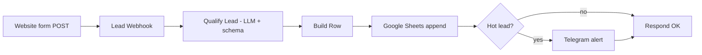

# Website lead to AI qualification

**Outcome:** Every website enquiry is scored, logged and the hot ones reach your phone in seconds.

A form or site posts a lead to an n8n webhook. An LLM scores intent and fit (1-10) with a structured output, the row lands in Google Sheets and hot leads trigger a Telegram alert.

## Credentials (referenced by name)

- OpenAI
- Google Sheets
- Telegram

## Setup

1. Import `workflows/01-website-lead-ai-qualification.json` (Workflows > Import from file).
2. Open each node with a credential warning and select your own credential.
3. Create a sheet tab `Leads` with columns: name, email, company, message, score, priority, reason, next_step, received_at. Set `YOUR_GOOGLE_SHEET_ID` and `YOUR_TELEGRAM_CHAT_ID`.
4. Point your form at `POST https://<your-n8n>/webhook/lead-intake` with JSON `{name, email, company, message}`.
5. Run it once with sample input, check the output of each node, then switch the workflow to Active.

## Customization

Change the scoring rules in the `Qualify Lead` system prompt, the `priority` threshold in `Hot Lead?`, or add a CRM node after the sheet.

---
Built by Gevorg Hovhannisyan — AI & automation engineer. Want this set up for your business? Portfolio https://gev44.github.io · Telegram @hovhannisyan77
