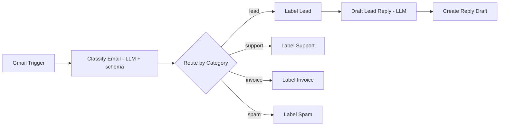

# Gmail triage

**Outcome:** The inbox sorts itself and every new lead already has a reply draft waiting.

A Gmail trigger polls new mail. An LLM returns a structured category (lead, support, spam, invoice) with confidence. A Switch applies the matching Gmail label; leads also get an AI-written reply saved as a draft in the same thread.

## Credentials (referenced by name)

- OpenAI
- Gmail

## Setup

1. Import `workflows/02-gmail-triage-classify-label-draft.json` (Workflows > Import from file).
2. Open each node with a credential warning and select your own credential.
3. Create the four labels in Gmail, then replace `Label_LEAD`, `Label_SUPPORT`, `Label_INVOICE`, `Label_SPAM` in the label nodes with your label IDs (pick them from the node dropdown).
4. Drafts are never sent automatically; you review and press send.
5. Run it once with sample input, check the output of each node, then switch the workflow to Active.

## Customization

Edit the category list in the schema and Switch, tune the reply tone in `Draft Lead Reply`, or add a Telegram node after `Label Support` for urgent tickets.

---
Built by Gevorg Hovhannisyan — AI & automation engineer. Want this set up for your business? Portfolio https://gev44.github.io · Telegram @hovhannisyan77
