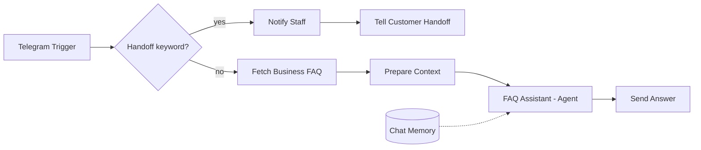

# Telegram AI assistant

**Outcome:** Customers get instant answers from your FAQ and a human steps in when they ask.

A Telegram bot receives a message. If it contains a handoff keyword, staff are notified and the customer is told a person will reply. Otherwise the FAQ is fetched from a URL and an AI agent with per-chat memory answers strictly from it.

## Credentials (referenced by name)

- OpenAI
- Telegram

## Setup

1. Import `workflows/03-telegram-ai-assistant-faq-handoff.json` (Workflows > Import from file).
2. Open each node with a credential warning and select your own credential.
3. Create a bot with @BotFather and add its token as the Telegram credential. Host your FAQ as plain text or markdown and set the URL in `Fetch Business FAQ`. Set `YOUR_STAFF_CHAT_ID`.
4. Memory is keyed by chat ID, so each customer keeps their own context (last 8 messages).
5. Run it once with sample input, check the output of each node, then switch the workflow to Active.

## Customization

Edit the keywords in `Handoff Keyword?` (English and Russian are preset), the assistant rules in the system message, or swap the HTTP node for a Google Sheets or Notion read.

---
Built by Gevorg Hovhannisyan — AI & automation engineer. Want this set up for your business? Portfolio https://gev44.github.io · Telegram @hovhannisyan77
