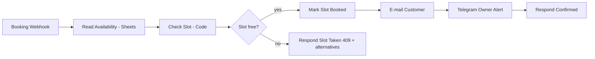

# Booking with availability check

**Outcome:** Booking requests are checked against your availability sheet and confirmed automatically.

A booking request hits a webhook. The workflow looks up the slot in a Google Sheet, books it if free (and confirms by e-mail and Telegram) or answers with up to three alternative slots.

## Credentials (referenced by name)

- Google Sheets
- Gmail
- Telegram

## Setup

1. Import `workflows/04-booking-availability-confirmation.json` (Workflows > Import from file).
2. Open each node with a credential warning and select your own credential.
3. Create a tab `Availability` with columns slot, status (`free` or `booked`), booked_by. One row per bookable slot, e.g. `2026-12-01 10:00`.
4. Send `POST https://<your-n8n>/webhook/booking-request` with JSON `{name, email, slot, service}`; `slot` must match a row exactly.
5. Run it once with sample input, check the output of each node, then switch the workflow to Active.

## Customization

Swap Sheets for Google Calendar or Cal.com, add an SMS node, or have the `Check Slot` code pick the nearest free slot automatically.

---
Built by Gevorg Hovhannisyan — AI & automation engineer. Want this set up for your business? Portfolio https://gev44.github.io · Telegram @hovhannisyan77
