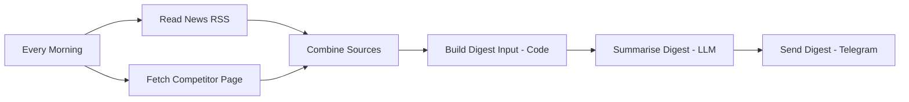

# Competitor and news monitor

**Outcome:** A short morning digest of what competitors and your industry did, without opening ten tabs.

On a daily schedule the workflow reads an RSS feed and fetches a competitor page in parallel, merges them, and an LLM writes a five-bullet digest with one suggested action, delivered to Telegram.

## Credentials (referenced by name)

- OpenAI
- Telegram

## Setup

1. Import `workflows/05-competitor-news-monitor-digest.json` (Workflows > Import from file).
2. Open each node with a credential warning and select your own credential.
3. Replace the example RSS and competitor URLs and set `YOUR_TELEGRAM_CHAT_ID`.
4. The schedule is 08:00 in the timezone set under Workflow settings.
5. Run it once with sample input, check the output of each node, then switch the workflow to Active.

## Customization

Duplicate the RSS or HTTP nodes to watch more sources, change the digest length in the system prompt, or send to Slack or e-mail instead.

---
Built by Gevorg Hovhannisyan — AI & automation engineer. Want this set up for your business? Portfolio https://gev44.github.io · Telegram @hovhannisyan77
