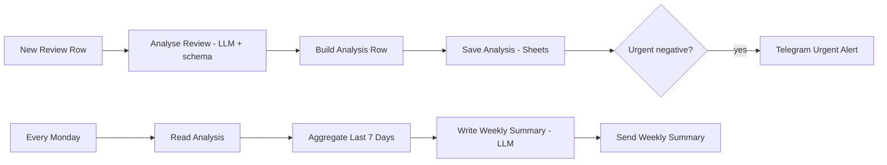

# Customer review analyzer

**Outcome:** Every review is tagged by sentiment and topic, and you get a weekly report on what customers think.

A Google Sheets trigger fires on each new review row. An LLM returns sentiment, topic, urgency and a summary, which is stored in an `Analysis` tab; urgent negatives alert you in Telegram. Every Monday a second branch aggregates the last 7 days and an LLM writes the weekly summary.

## Credentials (referenced by name)

- OpenAI
- Google Sheets
- Telegram

## Setup

1. Import `workflows/06-review-analyzer-sentiment-weekly-summary.json` (Workflows > Import from file).
2. Open each node with a credential warning and select your own credential.
3. Sheet tabs: `Reviews` (review, author, date) and `Analysis` (review, author, sentiment, topic, urgency, summary, analysed_at). Paste or auto-import reviews into `Reviews`.
4. Feed the `Reviews` tab from a form, an export, or another workflow.
5. Run it once with sample input, check the output of each node, then switch the workflow to Active.

## Customization

Edit the topic list in the prompt and schema, the urgency rule, or send the weekly summary by e-mail.

---
Built by Gevorg Hovhannisyan — AI & automation engineer. Want this set up for your business? Portfolio https://gev44.github.io · Telegram @hovhannisyan77
