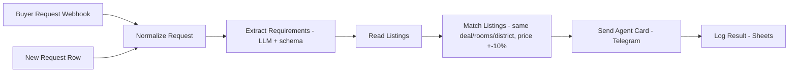

# Real estate lead matcher

**Outcome:** A buyer or renter request in plain Russian, Armenian or English becomes a Telegram card with the three best listings, in seconds.

A webhook (or a new row in the `Requests` tab) receives the free-text request. An LLM extracts `deal, rooms, budget, currency, district, move_in, pets`. The `Listings` tab is filtered by same deal, rooms and district and a price within 10% of the budget; owner listings rank before agency ones, then the closest price. The agent receives the top 3 as a Telegram card and the result is appended to `Matches`.

## Credentials (referenced by name)

- OpenAI
- Google Sheets
- Telegram

## Setup

1. Import `workflows/07-real-estate-lead-matcher.json` (Workflows > Import from file).
2. Open each node with a credential warning and select your own credential.
3. Sheet tabs: `Requests` (request, contact), `Listings` (id, deal, rooms, price, currency, district, address, owner_type, pets_allowed, url) and `Matches` (request, contact, criteria, match_count, match_ids, matched_at). `deal` is `rent` or `buy`, `owner_type` is `owner` or `agency`, `pets_allowed` is `yes` or `no`.
4. Set `YOUR_GOOGLE_SHEET_ID` and `YOUR_TELEGRAM_CHAT_ID`. To use the webhook, POST `{"text": "...", "contact": "..."}` to the production URL ending in `/buyer-request`.
5. Run it once with sample input, check the output of each node, then switch the workflow to Active.

## Customization

Change the 10% tolerance, the ranking (owners first) or the district matching in the `Match Listings` code node. Listings and budget must use the same currency; add a conversion step if your sheet mixes AMD and USD.

---
Built by Gevorg Hovhannisyan — AI & automation engineer. Want this set up for your business? Portfolio https://gev44.github.io · Telegram @hovhannisyan77
