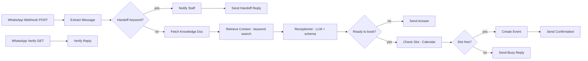

# WhatsApp AI receptionist

**Outcome:** Customers get instant answers in their own language, bookings land in your calendar and a human takes over when they ask.

The WhatsApp Cloud API posts every message to a webhook. If it contains a handoff keyword (human, оператор, մարդ and similar) staff get a Telegram note and the customer gets a short holding reply. Otherwise the knowledge doc is fetched, the most relevant paragraphs are picked by keyword scoring and an LLM answers only from them, in the customer's language. For booking requests with a complete date and time the slot is checked in Google Calendar, then the event is created and confirmed, or another time is offered.

## Credentials (referenced by name)

- OpenAI
- Google Calendar
- Telegram
- HTTP Header Auth named `WhatsApp Cloud API token` (value `Bearer <permanent token>`)

## Setup

1. Import `workflows/08-whatsapp-ai-receptionist.json` (Workflows > Import from file).
2. Open each node with a credential warning and select your own credential.
3. In Meta for Developers create a WhatsApp app, set the callback URL to the production webhook ending in `/whatsapp` and a verify token, and put the same token in `WhatsApp Verify Reply` (`YOUR_VERIFY_TOKEN`). Subscribe to the `messages` field.
4. Host the knowledge doc as plain text with paragraphs separated by a blank line and set the URL in `Fetch Knowledge Doc`. Set `YOUR_PHONE_NUMBER_ID`, `YOUR_CALENDAR_ID` and `YOUR_STAFF_CHAT_ID`.
5. Outside the 24-hour customer window WhatsApp requires approved templates; this workflow only replies to inbound messages.
6. Run it once with sample input, check the output of each node, then switch the workflow to Active.

## Customization

Edit the handoff keywords in `Extract Message`. For a large knowledge base replace `Retrieve Context` with a vector store (n8n embeddings and vector store nodes) feeding the same prompt. Change the booking length in the receptionist prompt.

---
Built by Gevorg Hovhannisyan — AI & automation engineer. Want this set up for your business? Portfolio https://gev44.github.io · Telegram @hovhannisyan77
