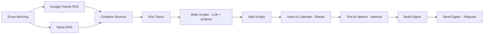

# AI reels content factory

**Outcome:** A week of short-video ideas, hooks and scripts is planned for you every morning, with a digest on your phone.

Every morning the workflow reads Google Trends and a niche RSS feed, de-duplicates the topics and asks an LLM to pick the 3 that fit a small business and write a hook, a 60 to 90 word script, a call to action and hashtags for each. The scripts are saved to a `Calendar` sheet with planned dates, an optional text-to-speech HTTP node can render voice-over, and the owner receives a Telegram digest.

## Credentials (referenced by name)

- OpenAI
- Google Sheets
- Telegram
- HTTP Header Auth named `TTS provider key` (only if you enable text to speech)

## Setup

1. Import `workflows/09-ai-reels-content-factory.json` (Workflows > Import from file).
2. Open each node with a credential warning and select your own credential.
3. Sheet tab `Calendar` with columns date, topic, hook, script, cta, hashtags, status. Notion works the same way: swap `Save to Calendar` for a Notion node.
4. Replace the niche feed URL and the Google Trends `geo` code. Set `YOUR_GOOGLE_SHEET_ID` and `YOUR_TELEGRAM_CHAT_ID`.
5. `Text to Speech (optional)` is disabled and points to a placeholder URL; enable it and adapt the body to your TTS provider.
6. Run it once with sample input, check the output of each node, then switch the workflow to Active.

## Customization

Describe your niche and tone in the `Write Scripts` prompt, change the schedule, or post the scripts to a team board instead of Telegram.

---
Built by Gevorg Hovhannisyan — AI & automation engineer. Want this set up for your business? Portfolio https://gev44.github.io · Telegram @hovhannisyan77
