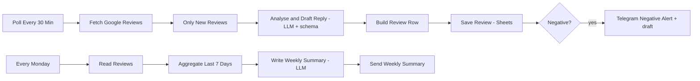

# Review reply and alert

**Outcome:** Every new Google review is tagged, answered with a ready draft in the customer's language, and bad ones reach you at once.

A schedule polls the Google Business Profile reviews endpoint (HTTP placeholder) every 30 minutes and keeps only reviews newer than the last run. An LLM returns sentiment, topic, language and a drafted reply in the review's language. Every review is saved to `Reviews`; negative ones trigger an instant Telegram alert with the draft. Every Monday a second branch aggregates the last 7 days and sends a weekly summary.

## Credentials (referenced by name)

- OpenAI
- Google Sheets
- Telegram
- OAuth2 API named `Google Business Profile OAuth2`

## Setup

1. Import `workflows/10-review-reply-and-alert.json` (Workflows > Import from file).
2. Open each node with a credential warning and select your own credential.
3. Sheet tab `Reviews` with columns review_id, author, stars, review, sentiment, topic, language, draft_reply, created_at.
4. In `Fetch Google Reviews` replace `YOUR_ACCOUNT_ID` and `YOUR_LOCATION_ID` and connect the OAuth2 credential (Business Profile API access must be approved by Google). Any other review source works if it returns the same fields.
5. Set `YOUR_GOOGLE_SHEET_ID` and `YOUR_TELEGRAM_CHAT_ID`. The workflow drafts replies but does not post them; copy the draft from the alert or sheet.
6. Run it once with sample input, check the output of each node, then switch the workflow to Active.

## Customization

Change the alert rule in `Negative Review?` (for example stars 2 or lower), the poll interval or the reply tone in the prompt.

---
Built by Gevorg Hovhannisyan — AI & automation engineer. Want this set up for your business? Portfolio https://gev44.github.io · Telegram @hovhannisyan77
